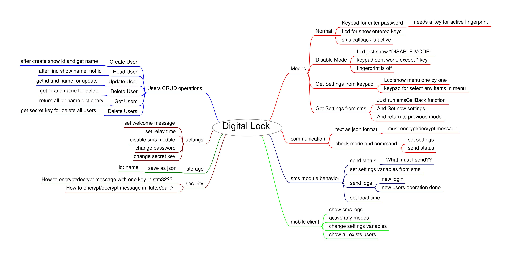
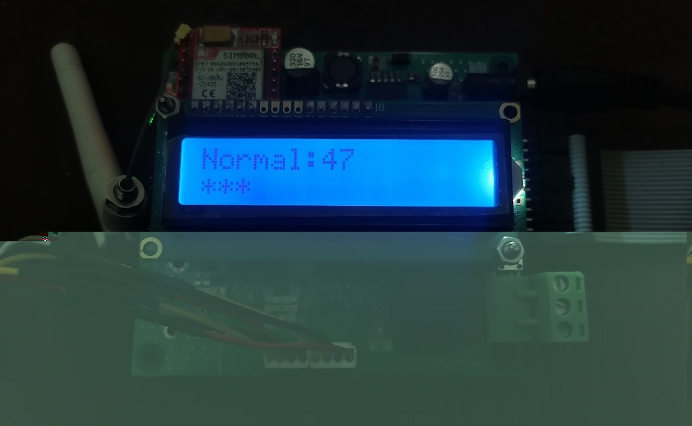
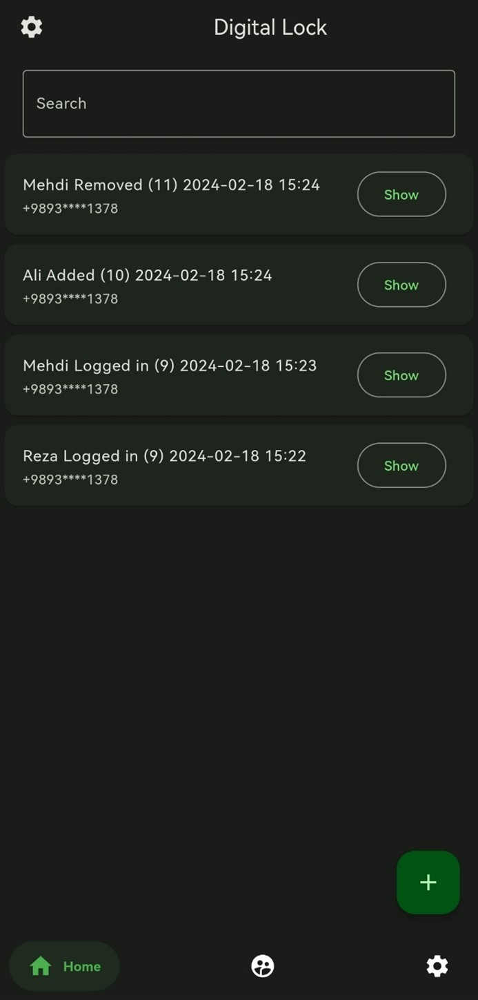

# Digital Lock

A smart digital door lock built with **STM32** and **FreeRTOS**, supporting multiple authentication methods including **fingerprint recognition**, **PIN keypad**, and **SMS-based remote control**. The project also includes a **Flutter** Android application for managing and interacting with the lock.

## Mind Map

---

## Overview

Digital Lock is an embedded systems project that combines hardware, firmware, and mobile software into a complete access control solution.

The firmware runs on an STM32 microcontroller using FreeRTOS to manage concurrent tasks such as user authentication, display updates, GSM communication, and peripheral control. A Flutter-based Android application provides a convenient interface for monitoring and controlling the system remotely.

---

## Screenshots

| Hardware | Android Client |
|----------|----------------|
|  |  |

---

## Getting Started

Each subproject contains its own documentation with build instructions and implementation details.

* [stm32code](./stm32code/digital-lock/README.md)
* [client](./client/digital_lock/README.md)

---

## System Architecture

The project consists of two main parts:

### Embedded Firmware

The firmware is responsible for:

* Managing authentication methods
* Driving the LCD interface
* Communicating with the GSM module
* Processing keypad input
* Interfacing with the fingerprint sensor
* Controlling the locking mechanism

### Mobile Application

The Flutter application provides:

* Remote interaction with the lock
* Device management
* User-friendly interface

---

## Technology Stack

### Embedded

* STM32
* FreeRTOS
* C
* STM32 HAL

### Mobile

* Flutter
* Dart
* Provider
* SQLite

### Communication

* GSM / SMS
* USART
* I2C
* JSON

### Hardware

* Fingerprint Sensor
* DS1307 RTC
* AT24Cxx EEPROM
* Matrix Keypad
* LCD

### Security

* AES
* SHA-256

### Development

* GNU Make
* OpenOCD
* ARM GNU Toolchain
* Android Studio

---

## License

This project is licensed under the [MIT](./LICENSE) License unless stated otherwise.

---
