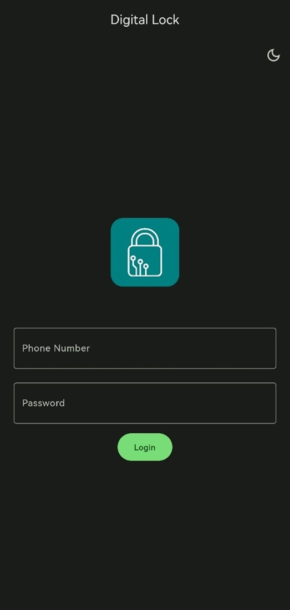
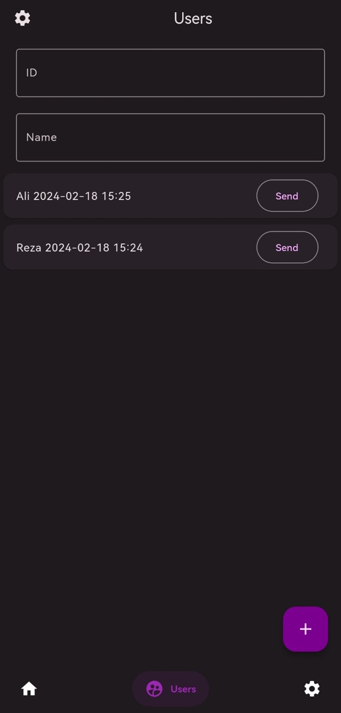
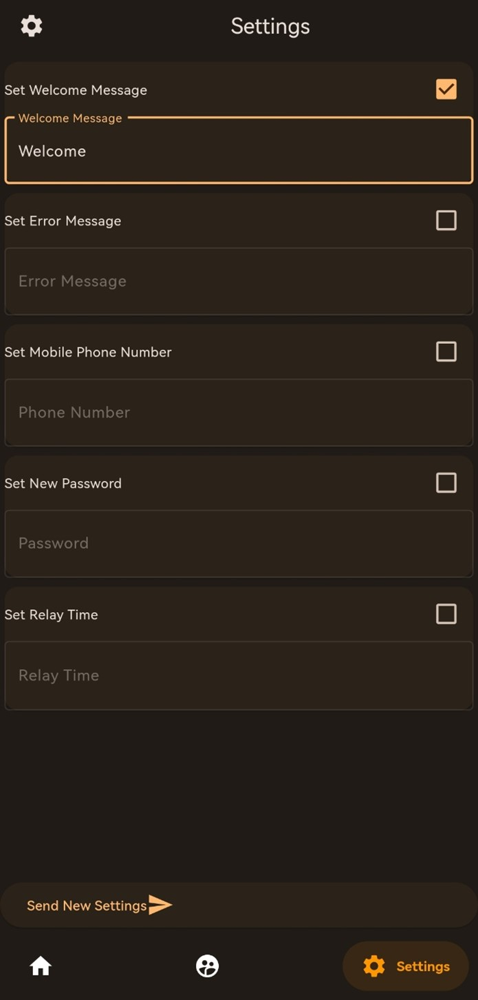

# Digital Lock Client

Flutter-based Android application for managing and controlling the **Digital Lock** system.

The application provides an intuitive interface for interacting with the embedded device, allowing users to authenticate, manage settings, and monitor the lock remotely.

---

## Features

* User authentication
* Manage registered users
* Configure lock settings
* Communicate with the Digital Lock device
* Modern Material Design interface
* Built with Flutter

---

## Technologies

* Flutter
* Dart
* Provider
* SQLite
* Shared Preferences

---

## Requirements

Install the following tools before building the project.

| Tool | Purpose |
| --- | --- |
| [Flutter](https://docs.flutter.dev/get-started/install) | Application development |
| [Android Studio](https://developer.android.com/studio/install) | Android SDK and emulator |
| [VS Code](https://code.visualstudio.com/) | Code editor |

---

## Getting Started

1. Install Dependencies

    ```bash
    flutter pub get
    ```

2. Build Release APK

    > Before creating a release build, configure Android app signing as described in the Flutter documentation.

    Then build the application:

    ```bash
    flutter build apk --release
    ```

The generated APK can be found at:

```bash
build/app/outputs/flutter-apk/app-release.apk
```

---

## Code Formatting

Format the source code using:

```bash
dart format .
```

---

## Screenshots

| Login Page | Main Page | User Page | Settings Page |
| --- | --- | --- | --- |
|  |  |  |  |

---

## License

This project is licensed under the MIT License unless stated otherwise.

---
