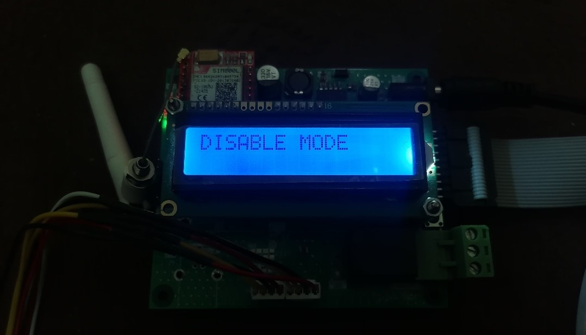
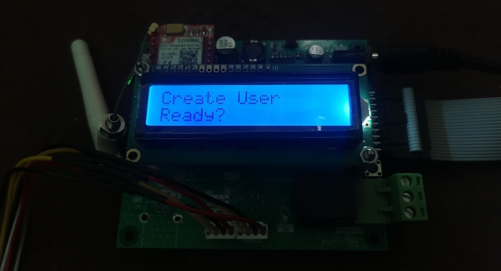

# STM32 Firmware

Firmware for the **Digital Lock** project, built on **STM32** and **FreeRTOS**.

The firmware controls all hardware peripherals including the fingerprint sensor, keypad, LCD, GSM module, and electronic lock while providing a responsive multitasking environment using FreeRTOS.

---

## Features

* FreeRTOS-based multitasking
* Fingerprint authentication
* PIN authentication via keypad
* LCD user interface
* GSM/SMS communication
* Electronic lock control
* Modular driver architecture
* Makefile-based build system

---

## Technologies

* STM32 HAL
* FreeRTOS
* C
* I2C
* USART
* DS1307
* AT24Cxx EEPROM
* AES
* SHA-256
* GNU Make
* OpenOCD

---

## Requirements

Before building the project, install the following tools:

| Tool | Purpose |
| --- | --- |
| [Arm Gnu Toolchain](https://developer.arm.com/downloads/-/arm-gnu-toolchain-downloads) | Cross compiler |
| [OpenOCD](https://openocd.org/pages/getting-openocd.html) | Flashing and debugging |
| [GNU Make](https://www.gnu.org/software/make/) | Build system |
| [Git](https://git-scm.com/) | Clone repository and submodules |
| [clang-format](https://clang.llvm.org/docs/ClangFormat.html) *(optional)* | Source code formatting |

---

## Getting Started

1. Clone the Submodules

    ```sh
    git submodule update --init --recursive
    ```

2. Build:

    Compile the firmware:

    ```sh
    make
    ```

    > The generated binary files will be placed in the build output directory.

3. Flash the Firmware:

    Connect an ST-Link (or another supported programmer) to the target board and run:

    ```sh
    make flush
    ```

---

## Code Formatting

Install **clang-format** and ensure it is available in your `PATH`.

Then run:

```sh
make format
```

---

## Screenshots

| Normal Mode | Disable Mode | Add User Mode |
| --- | --- | --- |
|  |  |  |

---

## License

This project is licensed under the MIT License unless stated otherwise.

---
